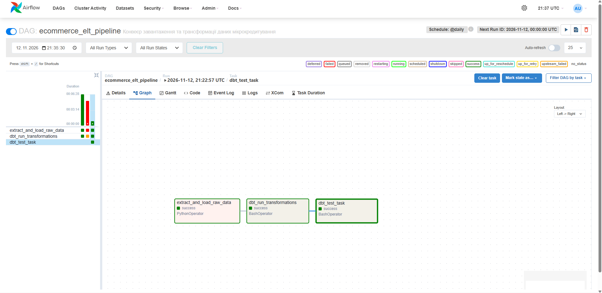

# Modern Data Stack: Мікрокредитування

Навчальний проєкт з дисципліни «Технології сховищ даних» (НУ «Львівська політехніка»).
Варіант 10: сервіс мікрокредитування.

Проєкт будується поступово, від генерації сирих даних до аналітичного дашборду:

| Етап | Що робиться | Інструменти | Статус |
|---|---|---|---|
| ЛР №1: Extract & Load | Генерація даних і завантаження в сирий шар `raw` | Python, Docker, PostgreSQL | ✅ |
| ЛР №2: Transform | Очищення даних і модель «Зірка» | dbt Core | ✅ |
| ЛР №3: Orchestration | Автоматичний запуск пайплайна за розкладом | Apache Airflow | ⏳ |
| ЛР №4: BI & Governance | Дашборди та Data Lineage | Metabase, dbt docs | ⏳ |

## Архітектура (ЛР №1)

```
data_generator.py (Python + Faker)
        │
        ├──► data_lake/*.parquet          (імітація Озера Даних)
        │
        └──► PostgreSQL у Docker          (сховище ecommerce_dwh)
                 └── схема raw            (дані «як є», без змін)
```

Дані потрапляють у схему `raw` без жодної обробки. Очищення відбудеться на наступному етапі (dbt, ЛР №2).

## Модель даних

**Виміри**

- `borrowers` (позичальники): ПІБ, email, телефон, місто, дата народження, місячний дохід, дата реєстрації
- `loan_types` (типи позик): назва, мінімальна та максимальна сума, річна ставка, максимальний термін
- `credit_scores` (кредитні рейтинги): бал 300–850, клас ризику A–E, кредитне бюро, дата оцінки

**Факти**

- `issued_loans` (видані кредити): позичальник, тип позики, сума, ставка, термін, дата видачі, статус
- `repayments` (погашення): кредит, позичальник, дата і сума платежу, спосіб оплати, прострочка, коментар

**Додаткове завдання ЛР №1**

- `reviews` (відгуки): `review_id`, `loan_type_id`, `borrower_id`, `rating` (1–5), `comment` (приблизно 20% порожні). Позичальники оцінюють кредитні продукти. Поля з методички `product_id` і `user_id` у цьому варіанті відповідають `loan_type_id` (тип позики) та `borrower_id` (позичальник).

```
loan_types ──< issued_loans >── borrowers ──── credit_scores
    │               │                │
    │               └──< repayments >┘
    │                                │
    └──────────< reviews >───────────┘
```

### Навмисні проблеми якості даних

У сирих даних спеціально залишено помилки, щоб у ЛР №2 їх очистити:

- приблизно 10% позичальників не мають email (`NULL`);
- приблизно 5% позичальників продубльовано;
- приблизно 20% платежів і 20% відгуків не мають коментаря (`NULL`).

## Як запустити

Потрібні: Python 3.9+, Git, Docker Desktop.

```bash
# 1. Клонувати репозиторій
git clone https://github.com/<ваш-логін>/modern-data-stack-ecommerce.git
cd modern-data-stack-ecommerce

# 2. Створити та активувати віртуальне середовище
python -m venv venv
venv\Scripts\activate          # Windows
# source venv/bin/activate     # macOS / Linux

# 3. Встановити залежності
pip install -r requirements.txt

# 4. Запустити сховище PostgreSQL у Docker
docker compose up -d

# 5. Згенерувати дані та завантажити їх у сховище
python data_generator.py
```

Скрипт можна запускати повторно: таблиці щоразу повністю перезаписуються (`if_exists='replace'`), тому дублів між запусками не буде.

### Перевірка результату

```bash
docker exec -it dwh_postgres psql -U admin -d ecommerce_dwh -c "\dt raw.*"
```

Параметри підключення до сховища: host `localhost`, порт `5432`, база `ecommerce_dwh`, користувач `admin`, пароль `adminpassword`.

## Трансформація даних (ЛР №2, dbt)

На цьому етапі сирі дані зі схеми `raw` очищуються та перетворюються на модель «Зірка» за методологією Кімбола. Усі трансформації написані як SQL-запити (SELECT) у dbt, результат записується у схему `analytics`.

```
схема raw (ЛР №1)          staging (views)            marts (tables, «Зірка»)
borrowers      ──────────► stg_borrowers   ─────────► dim_borrowers
loan_types     ──────────► stg_loan_types  ─────────► dim_loan_types
issued_loans   ──────────► stg_issued_loans ────────► fct_issued_loans
```

Відповідність прикладу з методички: `users` → `borrowers`, `products` → `loan_types`, `orders` → `issued_loans`.

### Структура dbt-проєкту

```
ecommerce_dbt/
├── dbt_project.yml              # налаштування проєкту: staging → view, marts → table
├── profiles.yml                 # підключення до DWH (не в Git, див. нижче)
└── models/
    ├── staging/                 # шар легкого очищення (views)
    │   ├── src_ecommerce.yml    # опис джерел: таблиці схеми raw
    │   ├── stg_borrowers.sql    # видалення дублікатів (ROW_NUMBER), NULL email → unknown@example.com
    │   ├── stg_loan_types.sql   # очищення «цін»: суми та ставка не менші за 0
    │   └── stg_issued_loans.sql # приведення типів, issue_date → issued_at
    └── marts/                   # вітрини даних, схема «Зірка» (tables)
        ├── dim_borrowers.sql    # вимір: позичальники
        ├── dim_loan_types.sql   # вимір: типи позик
        └── fct_issued_loans.sql # факт: видані кредити + total_amount
```

| Модель | Тип | Опис |
|---|---|---|
| `stg_borrowers` | view | Позичальники без дублікатів (1050 → 1000 рядків), порожні email замінено |
| `stg_loan_types` | view | Типи позик; `min_amount`, `max_amount`, `annual_interest_rate` не менші за 0 |
| `stg_issued_loans` | view | Видані кредити з приведеними типами |
| `dim_borrowers` | table | Вимір «Позичальник» |
| `dim_loan_types` | table | Вимір «Тип позики» |
| `fct_issued_loans` | table | Факт «Виданий кредит»; приєднано лише існуючих позичальників і типи позик |

`total_amount` у `fct_issued_loans` є аналогом `quantity * price` з методички: це сума до повернення з урахуванням відсотків,
`amount * (1 + annual_interest_rate / 100 * term_days / 365)`.

### Запуск dbt

```bash
cd ecommerce_dbt
set DBT_PROFILES_DIR=.             # Windows CMD
# $env:DBT_PROFILES_DIR="."        # Windows PowerShell
dbt debug                          # перевірка підключення
dbt run                            # побудова моделей у схемі analytics
```

Файл `profiles.yml` містить пароль до бази, тому додано в `.gitignore`. Для запуску створіть його в папці `ecommerce_dbt/`:

```yaml
ecommerce_dbt:
  target: dev
  outputs:
    dev:
      type: postgres
      host: localhost
      user: admin
      password: adminpassword
      port: 5432
      dbname: ecommerce_dwh
      schema: analytics
      threads: 4
      keepalives_idle: 0
```

## Структура репозиторію

```
├── data_generator.py    # генерація даних + завантаження в DWH (ЛР №1)
├── ecommerce_dbt/       # dbt-проєкт: трансформації та модель «Зірка» (ЛР №2)
├── docker-compose.yml   # контейнер PostgreSQL
├── requirements.txt     # Python-залежності
├── .gitignore
└── README.md
```

## Оркестрація (ЛР №3, Apache Airflow)

Конвеєр `ecommerce_elt_pipeline` (файл `airflow/dags/ecommerce_pipeline.py`) запускається щодня (`@daily`) і складається з трьох тасків:

1. `extract_and_load_raw_data` (PythonOperator) — генерація та завантаження «сирих» даних у схему `raw` (функція `load_data_to_dwh` з ЛР №1, `airflow/dags/scripts/data_generator.py`);
2. `dbt_run_transformations` (BashOperator) — `dbt run`, побудова staging- та marts-моделей (ЛР №2);
3. `dbt_test_task` (BashOperator) — `dbt test`, перевірка якості даних: `unique` та `not_null` для `stg_borrowers.borrower_id` (`ecommerce_dbt/models/staging/schema.yml`).

Залежності: `extract_load_task >> dbt_run_task >> dbt_test_task`.

Успішне виконання DAG-а (вкладка Graph):



Запуск (Airflow 2.11.2 у WSL2 Ubuntu):

```bash
export AIRFLOW_HOME=$(pwd)/airflow
airflow standalone
```
